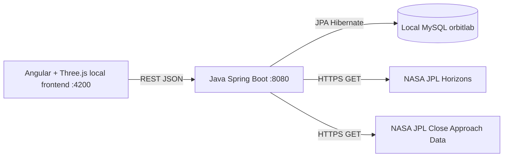
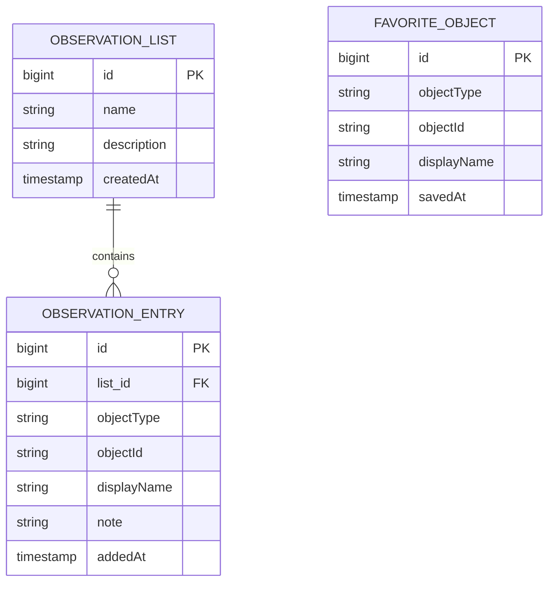

# ORBITLAB — SOA Technical Contract (Phase 8)

## Architecture

- All frontend calls to persisted data go through the Java service. No direct browser-to-MySQL access.
- The database stores one local profile's favorite objects and observation lists; no login exists.
- JPL calls are made by Java and cached. Planet graphics are visual approximations; Horizons samples are genuine scientific vectors.

## REST endpoints
| Method | Path | Purpose |
|---|---|---|
| GET | `/api/health` | Java health check |
| GET | `/api/planets` | Planet metadata |
| GET | `/api/planets/{id}` | Planet by ID |
| GET | `/api/ephemerides?date=YYYY-MM-DD` | Horizons heliocentric positions |
| GET | `/api/asteroids/close-approaches` | JPL near-Earth close approaches |
| GET | `/api/observatory/favorites` | Read favorites |
| POST | `/api/observatory/favorites` | Add favorite |
| DELETE | `/api/observatory/favorites/{id}` | Remove favorite |
| GET | `/api/observatory/lists` | Read lists |
| POST | `/api/observatory/lists` | Create list |
| PUT | `/api/observatory/lists/{id}` | Edit list |
| DELETE | `/api/observatory/lists/{id}` | Delete list |
| GET | `/api/observatory/lists/{id}/entries` | Read list entries |
| POST | `/api/observatory/lists/{id}/entries` | Add list entry |
| DELETE | `/api/observatory/lists/{id}/entries/{entryId}` | Remove entry |

### REST behavior
- POST returns 201; DELETE returns 204; GET and PUT return 200.
- Invalid validated JSON returns 400; missing resources return 404; duplicate favorite/entry returns 409.
- External NASA/JPL failures return 502 if no cached result is available.
- Planet object identifiers are lowercased for persistence. API does not offer multiuser authorization.

## Persistence model

Favorites and entries may refer to planets or asteroids. Object IDs are logical references, not foreign keys to a NASA data table.

## Academic validation
1. Java is a genuinely implemented REST service with database-backed CRUD.
2. Angular consumes Java service via HTTP.
3. Java consumes external NASA/JPL services, independent of the frontend.
4. Maven integration tests use H2 in CI; local MySQL smoke test must still be performed.
5. Angular build CI checks TypeScript compilation. Neither CI pipeline replaces an end-to-end browser/GPU test.

## Security boundary
Development-only and localhost-oriented. CORS allows localhost:4200; this is **not authentication**. There are no accounts or authorization, so do not publish the backend with public access.

## Data truthfulness
Horizons: real time-indexed positions using heliocentric ecliptic reference, with visual radial compression. Rotation, cloud motion, textures, ring patterns and physical scale are stylized, not observationally verified for the selected instant.
