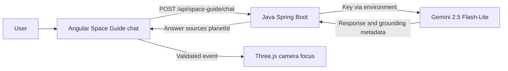

# OrbitLab Space Guide — Gemini integration

## What it does
An astronomy-only, Gemini-powered interactive assistant in the Angular Three.js scene. Its messages render as sanitized Markdown with animated reveal. Verifiable citations appear as separate clickable source links **only if Gemini's Google Search grounding returned them**. A planet action can focus the camera on an explicitly mentioned single planet.

## How it works


## Free API setup (no key stored in Git)
1. Create a **free-tier API key** at https://aistudio.google.com/apikey .
2. Start Spring Boot from PowerShell with `$env:GEMINI_API_KEY="YOUR_KEY"`. This must be done in the **same terminal** that runs `mvn spring-boot:run`.
3. Optionally set `$env:GEMINI_MODEL="gemini-2.5-flash-lite"`.
4. Visit `http://localhost:8080/api/space-guide/status` and check `configured:true`.
5. Run Angular locally and open the floating **SPACE GUIDE** button.

Google lists Gemini 2.5 Flash-Lite as free-tier eligible (subject to quotas, region, and policy). Search grounding is free within published daily limits and may be unavailable for some model or account configurations. If Google changes model or quota availability, adjust `GEMINI_MODEL` and confirm compatibility. Google may use free-tier content to improve its products: **don't send private data**. No billing-enabled project is required for normal supported free-tier access.

## Backend API

`GET /api/space-guide/status` → `{"configured":true,"model":"gemini-2.5-flash-lite","localOnly":true}`

`POST /api/space-guide/chat`

```json
{"message":"Why is Mars red?","selectedPlanet":"earth","history":[]}
```

Example response *shape*:
```json
{
 "answer":"**Mars** appears red because ...",
 "sources":[{"title":"NASA Mars Overview","url":"https://science.nasa.gov/mars/"}],
 "navigatePlanet":"mars",
 "model":"gemini-2.5-flash-lite",
 "grounded":true
}
```

Sources in this example are illustrative, **not a claim that Gemini returned them**. Missing grounding yields an empty `sources` array with a visible "No verified sources returned" notice. The navigation target is based on one unambiguous planet in the user's query, not model-generated commands; no arbitrary tool execution.

## Scope and security
The system prompt limits answering to space, astronomy, and OrbitLab usage. This is guidance, **not a mathematically guaranteed content filter**; the model can still make mistakes and should not be trusted for high-stakes decisions. Server-side code allows at most eight requests per minute per local instance, truncates history to six messages and limits user prompt length.

The Gemini key stays in Spring Boot's environment. No public deployment, multi-user auth, or per-user quotas are implemented. Don't expose the backend to the internet, and don't log or commit the API key.

## Tests
`mvn clean test` covers unconfigured keys, basic prompt validation, and planet routing. A real Gemini end-to-end test requires a key, internet, and available free-tier quota.
