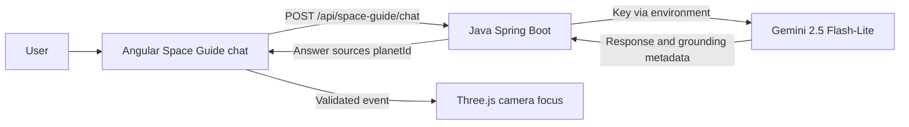

# OrbitLab Space Guide — Gemini integration

## What it does
An astronomy-only, Gemini-powered interactive assistant in the Angular Three.js scene. Its messages render as sanitized Markdown with animated reveal. Verifiable citations appear as separate clickable source links **only if Gemini's Google Search grounding returned them**. A planet action can focus the camera on an explicitly mentioned single planet.

## How it works


## Free API setup (no key stored in Git)
1. Create a **free-tier API key** at https://aistudio.google.com/apikey .
2. Start Spring Boot from PowerShell with `$env:GEMINI_API_KEY="YOUR_KEY"`. This must be done in the **same terminal** that runs `mvn spring-boot:run`.
3. Optionally set `$env:GEMINI_MODEL="gemini-2.5-flash-lite"`.
4. Visit `http://localhost:8080/api/space-guide/status` and check `configured:true`.
5. Run Angular locally and open the floating **SPACE GUIDE** button.

Google lists Gemini 2.5 Flash-Lite as free-tier eligible (subject to quotas, region, and policy). Search grounding is free within published daily limits and may be unavailable for some model or account configurations. If Google changes model or quota availability, adjust `GEMINI_MODEL` and confirm compatibility. Google may use free-tier content to improve its products: **don't send private data**. No billing-enabled project is required for normal supported free-tier access.

## Backend API

`GET /api/space-guide/status` → `{"configured":true,"model":"gemini-2.5-flash-lite","localOnly":true}`

`POST /api/space-guide/chat`

```json
{"message":"Why is Mars red?","selectedPlanet":"earth","history":[]}
```

Example response *shape*:
```json
{
 "answer":"**Mars** appears red because ...",
 "sources":[{"title":"NASA Mars Overview","url":"https://science.nasa.gov/mars/"}],
 "navigatePlanet":"mars",
 "model":"gemini-2.5-flash-lite",
 "grounded":true
}
```

Sources in this example are illustrative, **not a claim that Gemini returned them**. Missing grounding yields an empty `sources` array with a visible "No verified sources returned" notice. The navigation target is based on one unambiguous planet in the user's query, not model-generated commands; no arbitrary tool execution.

## Scope and security
The system prompt limits answering to space, astronomy, and OrbitLab usage. This is guidance, **not a mathematically guaranteed content filter**; the model can still make mistakes and should not be trusted for high-stakes decisions. Server-side code allows at most eight requests per minute per local instance, truncates history to six messages and limits user prompt length.

The Gemini key stays in Spring Boot's environment. No public deployment, multi-user auth, or per-user quotas are implemented. Don't expose the backend to the internet, and don't log or commit the API key.

## Tests
`mvn clean test` covers unconfigured keys, basic prompt validation, and planet routing. A real Gemini end-to-end test requires a key, internet, and available free-tier quota.

## November 2026 free-tier compatibility and 502 diagnostics

ASTRA now defaults to `gemini-3.1-flash-lite` with `GEMINI_SEARCH_GROUNDING=false` for **free-tier text generation**. Google's Gemini 3+ models do not include API Google Search grounding on the free tier. If you have an existing API key with a working `gemini-2.5-flash-lite` entitlement, you can explicitly select it and enable `GEMINI_SEARCH_GROUNDING=true` (subject to that model's free search quotas).

PowerShell:
```powershell
$env:GEMINI_API_KEY="YOUR_PRIVATE_KEY"
$env:GEMINI_MODEL="gemini-3.1-flash-lite"
$env:GEMINI_SEARCH_GROUNDING="false"
mvn spring-boot:run
```

Visit `GET /api/space-guide/status` for the effective model and grounding setting.
If the backend returns HTTP 502, Angular now shows the **sanitized Google error reason**, distinguishing invalid keys, unavailable models, unsupported tools, quota exhaustion, and temporary provider errors. A missing citation indicates ungrounded generated text: **never present it as verified by Google Search**.

If you wish to try another model, first verify its availability in Google AI Studio. Do not enable billing just to make the project demo work.


## Multiple Gemini credentials: bounded availability failover

The local backend accepts up to three additional Gemini API keys using `GEMINI_API_KEY_1`, `GEMINI_API_KEY_2`, and `GEMINI_API_KEY_3`. The legacy `GEMINI_API_KEY` remains supported as an optional fallback. Keys are filtered for duplicates, and `/api/space-guide/status` reports the number of configured keys without revealing any secrets.

Request selection is round-robin. On a **temporary upstream 503/504** or network timeout, the backend can try the next configured credential with an 11-second timeout per attempt. It does **not** rotate keys after HTTP 429 quota/rate-limit responses, 401/403 authorization failures, 400 invalid requests or 404 unavailable models. This feature is for resilience of legitimately authorized projects, not bypassing per-project or account limits. Different keys accessing the same overloaded model may all get 503; key rotation cannot guarantee availability.

Set variables in the same PowerShell terminal as Spring Boot (do not paste secrets into source code):

```powershell
$env:GEMINI_API_KEY_1 = Read-Host "Gemini key 1"
$env:GEMINI_API_KEY_2 = Read-Host "Gemini key 2"
$env:GEMINI_API_KEY_3 = Read-Host "Gemini key 3"
$env:GEMINI_MODEL = "gemini-3.1-flash-lite"
$env:GEMINI_SEARCH_GROUNDING = "false"
mvn spring-boot:run
```

For a single key, continue using `GEMINI_API_KEY`. Real availability and free-tier eligibility are governed by Google's terms, project quotas and current model capacity. The backend local demo request guard still limits requests to eight per minute.


## Capacity fallback (November 2026)

ASTRA now defaults to **`gemini-3.5-flash-lite`** (primary) and **`gemini-3.1-flash-lite`** (fallback). Both currently list free text-generation access, subject to project eligibility and provider capacity. A single question triggers one primary attempt, then one fallback only on upstream 503/504, a network timeout, or model-unavailable 404. It does **not** try every key on the same overloaded model; 429 quota, authentication and invalid-request errors stop immediately.

```powershell
$env:GEMINI_MODEL="gemini-3.5-flash-lite"
$env:GEMINI_FALLBACK_MODEL="gemini-3.1-flash-lite"
$env:GEMINI_SEARCH_GROUNDING="false"
mvn spring-boot:run
```

The response's `model` field shows which model actually answered. Visit `GET /api/space-guide/status` to confirm the effective settings. It is normal to have four configured credentials if the original `GEMINI_API_KEY` is still set as well as `_1`, `_2` and `_3`; extra keys do not fix model-wide 503 errors.

For a guaranteed offline presentation fallback, prewrite static astronomy FAQs and label them as curated, non-AI material; the present backend does not automatically fake Gemini output.


## Groq provider (free alternative to overloaded Gemini)

Groq currently offers free-tier access with usage quotas. Use Groq's **GPT-OSS 20B** model to test a lightweight and fast astronomy chat; the **GPT-OSS 120B** model may be an alternative if your plan supports it. Do not use the older Llama 3.1 8B or Llama 3.3 70B model IDs for free-tier usage; Groq deprecated them for free and developer tiers in August 2026.

1. Create a Groq key at https://console.groq.com/keys .
2. Use PowerShell **in the terminal from which you start Spring Boot**:
   ```powershell
   $env:GROQ_API_KEY = [System.Net.NetworkCredential]::new("", (Read-Host "Groq API key" -AsSecureString)).Password
   $env:ASTRA_AI_PROVIDER = "groq"
   $env:GROQ_MODEL = "openai/gpt-oss-20b"
   mvn spring-boot:run
   ```
3. Open http://localhost:8080/api/space-guide/status . Expect `provider:"groq"`, `configured:true`, `groqConfigured:true`.
4. Test one question in PowerShell:
   ```powershell
   $payload = @{ message = "Why is Mars red?"; selectedPlanet = "mars"; history = @() } | ConvertTo-Json
   Invoke-RestMethod -Uri "http://localhost:8080/api/space-guide/chat" -Method Post -ContentType "application/json" -Body $payload
   ```
5. Start Angular and open ASTRA. The frontend displays Groq as the active AI provider automatically.

The Java API endpoint and response shape are unchanged; no frontend API keys and no SDK dependency. `ASTRA_AI_PROVIDER=auto` selects Groq when a Groq key exists, otherwise Gemini. `ASTRA_AI_PROVIDER=gemini` forces the legacy Gemini provider. Other Gemini credentials may remain configured, but Groq mode does not call them. Chat completion is not real-time web search: response `sources:[]`, `grounded:false`; the UI truthfully notes that verified links were not returned. The planet-navigation button still works for an unambiguous planet question.

Groq docs: https://console.groq.com/docs/api-reference , https://console.groq.com/docs/models , https://console.groq.com/docs/rate-limits .
